<div align="center">


# shelfIt

**A self-hosted PWA for tracking the movies and TV shows your household owns and watches, styled like a physical video-rental shelf.**


</div>

---

shelfIt is a personal media library for one person and their household. It pulls
rich metadata and artwork from The Movie Database, lays your collection out as a
tactile shelf of DVD spines and disc art, and tracks what you own, what you have
watched, per-episode progress for series, ratings, and viewing statistics. It is
designed to be run at home in Docker, installed to the home screen as a Progressive
Web App, and used comfortably offline. It optionally talks to a local Kodi instance
so you can start playback from your phone, and it can pull in your history from a
TV Time export or an existing Kodi library.

It is deliberately **not** a multi-tenant service: one instance serves one
household. Every member picks their profile on a Netflix-style sign-in screen and
has a private library behind their own password; one **master** account, created
from `APP_PASSWORD` on first boot, runs the instance. All data lives in a single
SQLite database and cache folder that you own.

> **In a hurry?** Jump to [Running shelfIt](#running-shelfit). There are two
> supported setups: [**A. localhost / LAN only**](#a-localhost--lan-only)
> (five small edits, no proxy) and [**B. Tailscale + Caddy**](#b-tailscale--caddy-recommended)
> (keep the defaults, reach it over your tailnet). Read
> [The `/shelfit/` base path](#the-shelfit-base-path-read-this-first) first: it is
> the one thing that trips up every new deployment.

## Contents

- [Screenshots](#screenshots)
- [Features](#features)
- [Tech stack](#tech-stack)
- [Prerequisites](#prerequisites)
- [The `/shelfit/` base path](#the-shelfit-base-path-read-this-first)
- [Running shelfIt](#running-shelfit)
  - [A. localhost / LAN only](#a-localhost--lan-only)
  - [B. Tailscale + Caddy](#b-tailscale--caddy-recommended)
  - [Serving it under a different sub-path](#serving-it-under-a-different-sub-path)
- [Configuration](#configuration)
- [Data layout](#data-layout)
- [Settings tour](#settings-tour)
- [Household accounts](#household-accounts)
  - [Lending a title](#lending-a-title)
- [Import guides](#import-guides)
- [Kodi integration](#kodi-integration)
- [Updating the app](#updating-the-app)
  - [Upgrading from a single-user version](#upgrading-from-a-single-user-version)
- [Backup and restore](#backup-and-restore)
- [Development](#development)
- [Troubleshooting](#troubleshooting)
- [Contributing](#contributing)
- [License](#license)
- [AI disclaimer](#ai-disclaimer)

## Screenshots

<table>
  <tr>
    <td width="33%">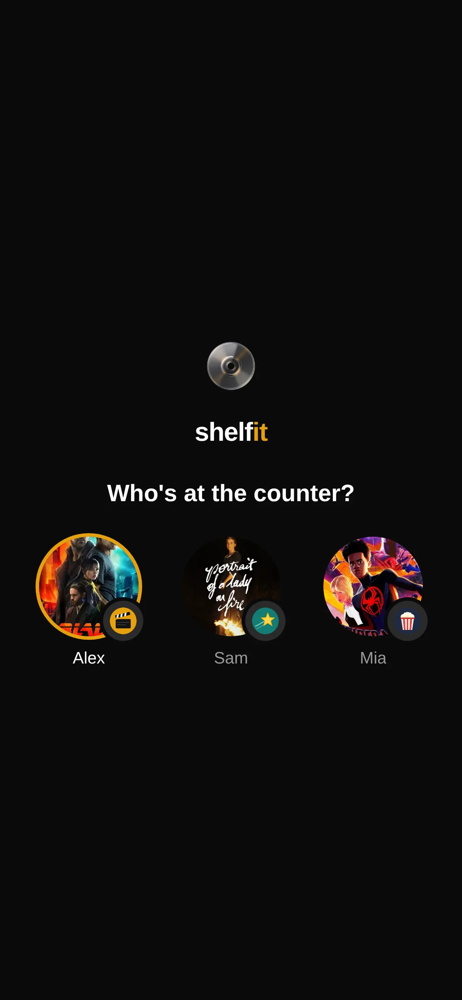<br /><sub><b>Who's at the counter?</b>: one profile per household member, each with a badge and their own password</sub></td>
    <td width="33%">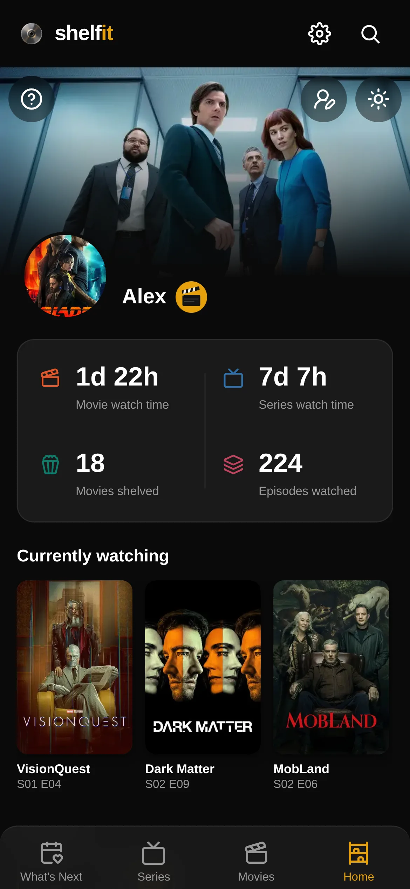<br /><sub><b>Home</b>: your profile, watch time & what you're watching</sub></td>
    <td width="33%">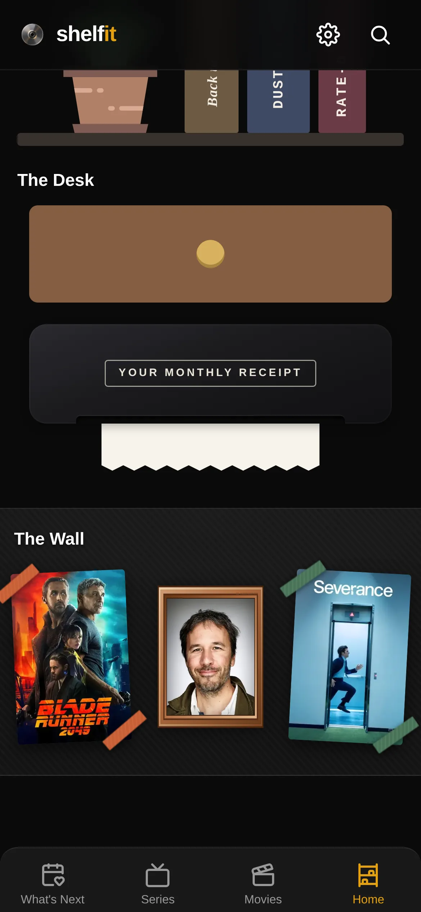<br /><sub><b>The Desk & The Wall</b>: ticket drawer, receipt printer, taped-up favourites</sub></td>
  </tr>
  <tr>
    <td>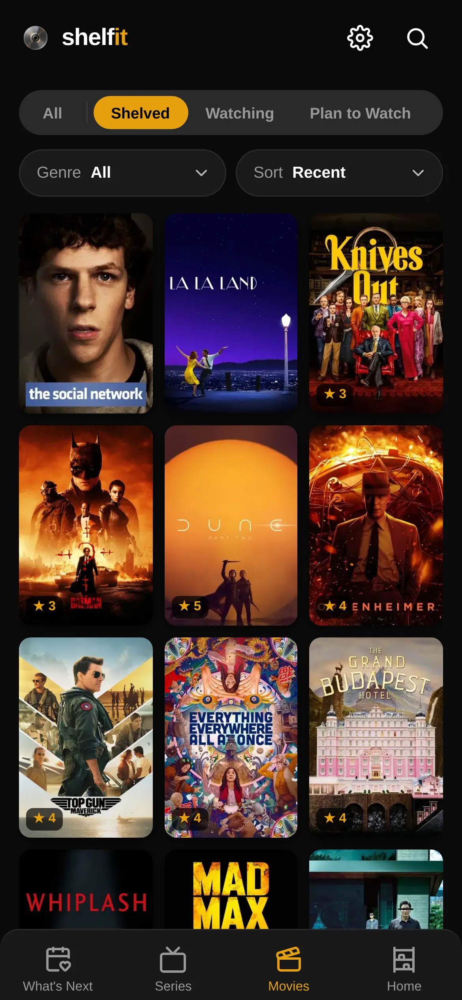<br /><sub><b>Movies</b>: virtualised poster grid with filters & ratings</sub></td>
    <td>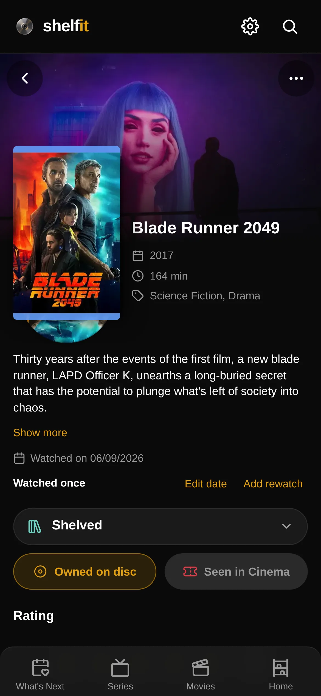<br /><sub><b>Detail</b>: disc art, status, ownership, cinema ticket</sub></td>
    <td>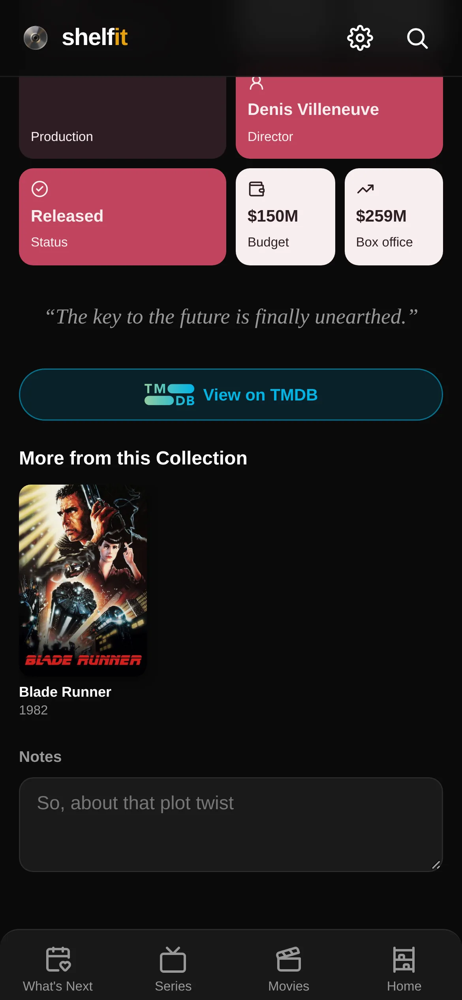<br /><sub><b>Liner Notes</b>: production, director, budget & tagline</sub></td>
  </tr>
  <tr>
    <td>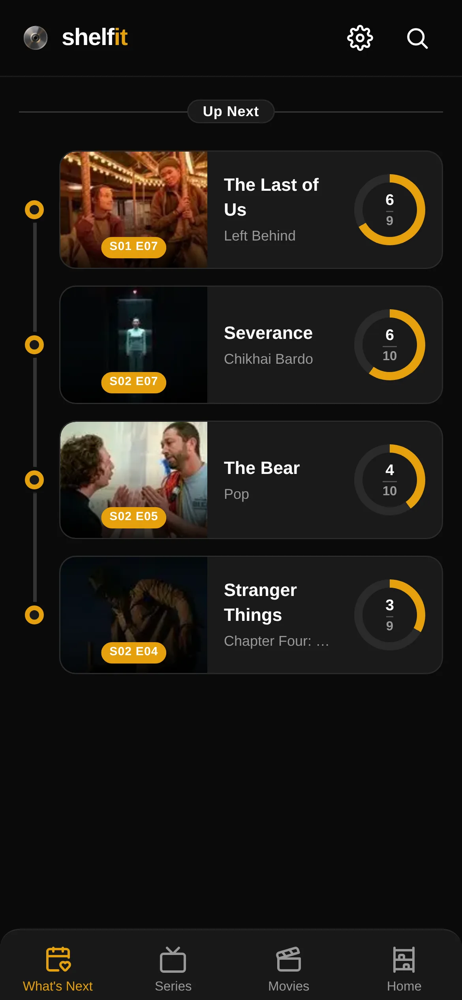<br /><sub><b>What's Next</b>: On the Horizon + Up Next progress</sub></td>
    <td>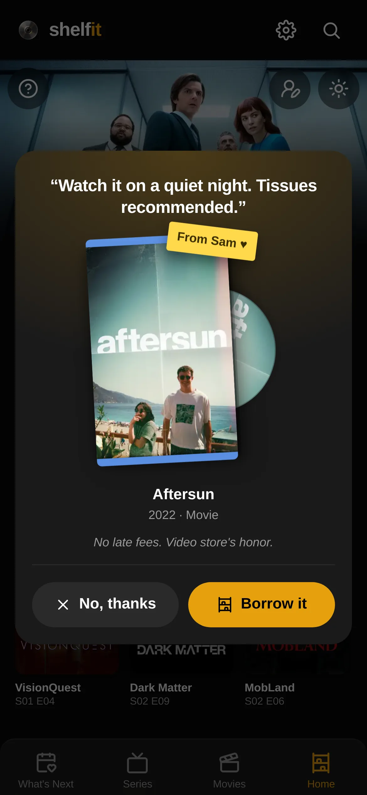<br /><sub><b>Lend a title</b>: a member passes you a DVD, with a note</sub></td>
    <td>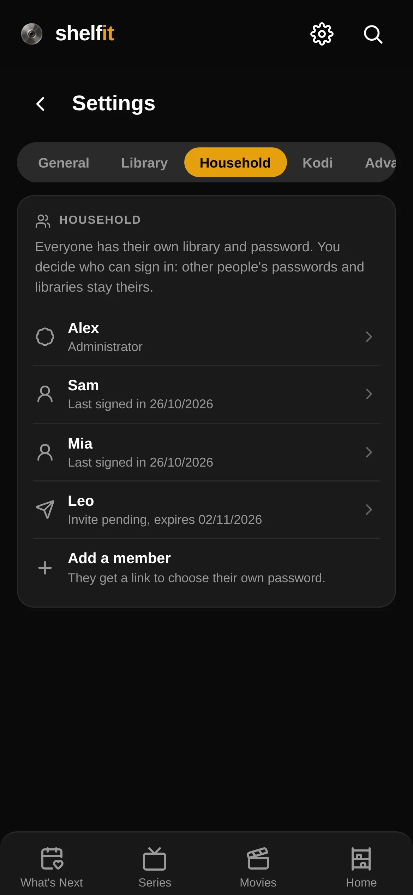<br /><sub><b>Household</b>: members, invites and who can sign in</sub></td>
  </tr>
  <tr>
    <td>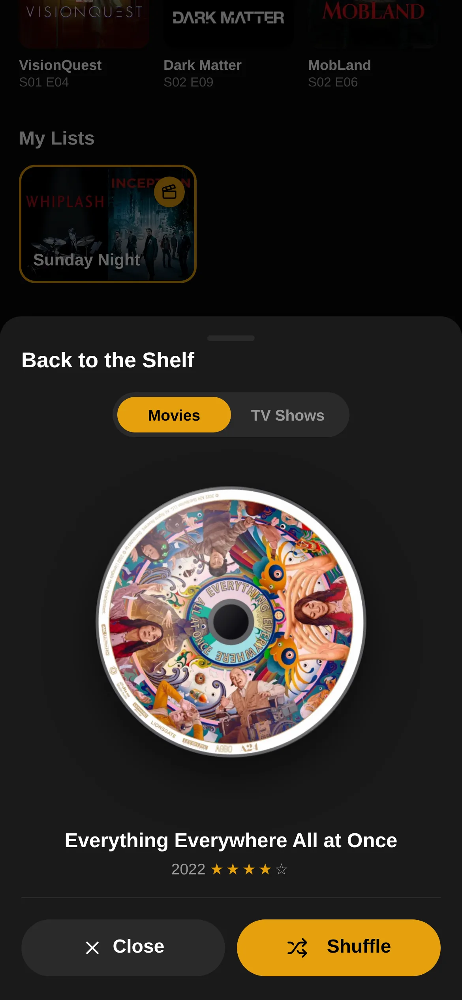<br /><sub><b>Back to the Shelf</b>: spin up a disc you have already watched</sub></td>
    <td>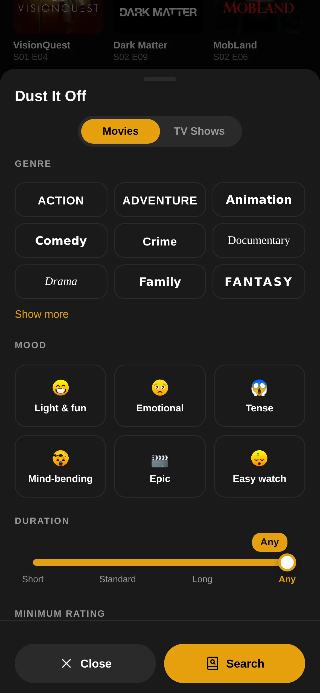<br /><sub><b>Dust It Off</b>: pick by mood, duration, rating & era</sub></td>
    <td>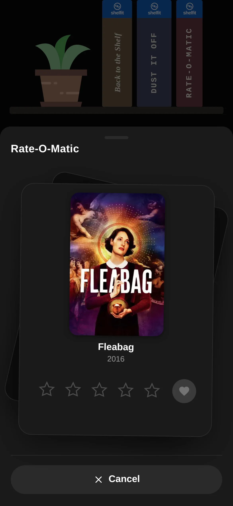<br /><sub><b>Rate-O-Matic</b>: quick-rate everything still unrated</sub></td>
  </tr>
  <tr>
    <td>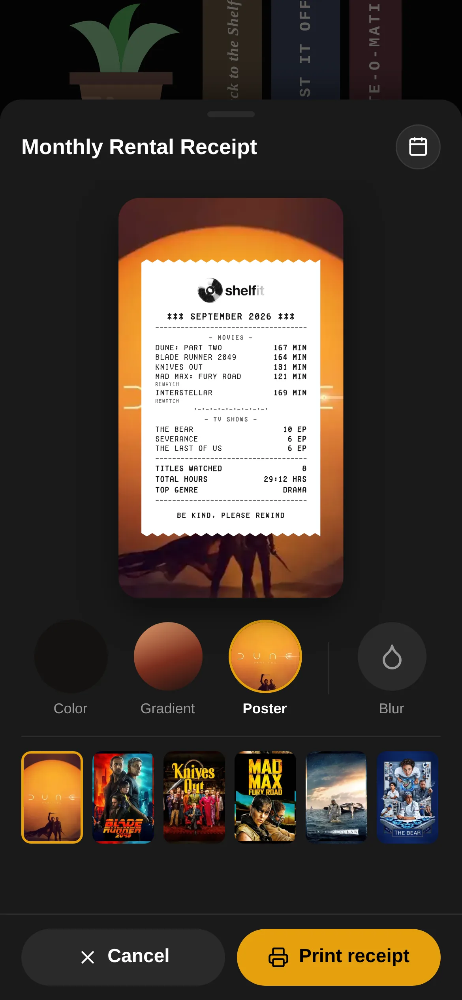<br /><sub><b>Rental receipt</b>: a shareable monthly wrap-up per member</sub></td>
    <td>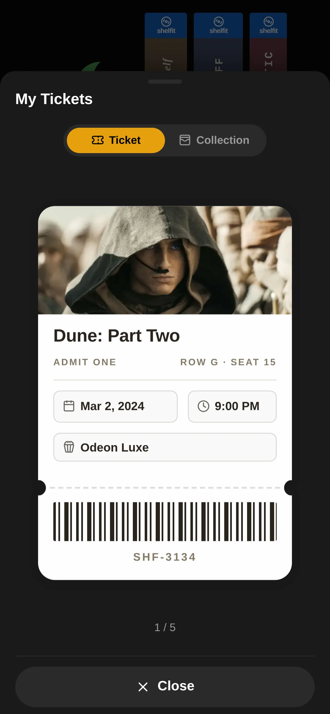<br /><sub><b>My Tickets</b>: a ticket per cinema screening, swipeable</sub></td>
    <td>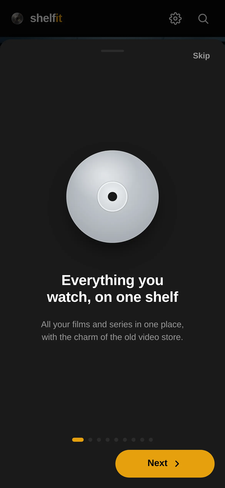<br /><sub><b>Showcase</b>: the illustrated tour shown on first launch</sub></td>
  </tr>
</table>

<sub>Screenshots come from a demo household built for this README: Alex, Sam and Mia, three invented members with their own libraries, ratings and watch history over real TMDB titles. The profile badges were drawn for the demo.</sub>

## Features

### Your library

- Movies and series with watch status, rating, notes, watch dates and dated
  rewatches, plus **Owned on disc** for what is physically on your shelf.
- Per-episode progress for series: mark a season at once, get a catch-up prompt
  when you skipped episodes, track rewatches.
- Box-set collections with owned-vs-total progress, and your own lists.
- Fast poster grids for Movies and Series, filtered by status, ownership and genre
  and sorted by date added, title (with an A–Z jump strip) or rating.

### Finding what to watch

- TMDB search with a preview before you add anything, and **Explore** rows:
  trending, in theaters, popular and mood-based.
- **What's Next**: *On the Horizon* (episodes about to air) above *Up Next* (the
  next unwatched episode of everything you are watching).
- **Back to the Shelf** spins up something you have already watched, **Dust It
  Off** suggests something new by mood, length, rating and era, and
  **Rate-O-Matic** rates everything still unrated in one go.
- Person pages with a filmography split by what is already in your library.

### The video store feel

- A shelf-style home with DVD spines, disc art, watch-time stats and what you are
  watching right now.
- **The Wall**: your favourite film, series and person, taped up on the home
  screen.
- **Cinema tickets**: mark a movie as seen in a cinema and it becomes a ticket in
  the desk drawer, with date, time and cinema.
- **Monthly Rental Receipt**: the month as a 1990s thermal receipt (movies,
  rewatches, episodes, hours, top genre), for any past month, saved as an image to
  share.

### Built for a household

- One instance per household. Everyone picks their profile on the sign-in screen
  and has their own password; libraries, progress, stats, lists and receipts are
  private to each member.
- The master account (from `APP_PASSWORD`) invites members with a one-time link,
  so it never learns their passwords, and can rename, disable, reset or remove
  them. See [Household accounts](#household-accounts).
- **Lend a title** to another member with a short note: they get a notification
  and a popup the next time they open the app.
- Safe on shared devices: **Switch profile** forgets the previous member's
  on-device data.

### On your phone

- Installable PWA (Android and iOS) that opens instantly from a local cache and
  keeps the home screen, What's Next and Plan to Watch pages working offline.
- Push notifications for new episodes of the shows you are watching and for
  titles lent to you.
- Share a TMDB link from any app and shelfIt opens that title.
- English or Italian interface, a separate language for titles and plots, and a
  system, dark or light theme.

### Kodi (optional)

- **Play on Kodi** from a title's page, and a **Now Playing** indicator with
  one-tap *Mark as watched*.
- A daily library sync that only moves progress forward and asks you to review
  new titles before adding them. See [Kodi integration](#kodi-integration).

### Import, backup and security

- Import your history from TV Time (CSV) or a Kodi library (XML). Each member can
  back up and restore their library as XML: merge-only, never deletes, checksum
  verified.
- Optional Fanart.tv artwork (clear logos, disc art), on-disk and in-memory image
  caches, and monthly API budgets you set yourself.
- Passwords hashed with scrypt, magic-link sign-in, a list of signed-in devices
  with per-device sign-out, *Sign out of all devices*, an access log that stores
  only hashed IPs, and per-IP rate limiting.

## Tech stack

| Layer | Technology | Version |
| --- | --- | --- |
| Runtime | Node.js | 22 |
| Backend | Fastify | ^4 |
| Database | SQLite via better-sqlite3 | ^9 |
| Frontend | Vanilla JavaScript (no framework) | — |
| Build / dev | Vite | ^5 |
| Metadata | The Movie Database (TMDB) API | v3 |
| Artwork (optional) | Fanart.tv API | v3 |
| Media control (optional) | Kodi JSON-RPC | — |
| Image tooling | cwebp (libwebp-tools) | runtime |
| Packaging | Docker (multi-stage, `node:22-alpine`) | — |
| Reverse proxy (optional) | Caddy | 2 |

There are **no runtime dependencies beyond the five in `package.json`** — push
notifications, the XML parser, the image pipeline and every visual effect are
built on Node and browser primitives.

## Prerequisites

- **Docker** and Docker Compose (the supported way to build and run).
- A free **TMDB API key** — required. Create an account at
  [themoviedb.org](https://www.themoviedb.org/) and request a v3 API key under
  Settings → API.
- _Optional_ **Fanart.tv API key** for higher-quality logos and disc art —
  [fanart.tv/get-an-api-key](https://fanart.tv/get-an-api-key/).
- _Optional_ **Kodi** instance on your LAN for remote playback and sync.
- _Optional_ **Tailscale** on the host and on every device that should reach the
  app, for setup B.
- For local (non-Docker) development only: **Node.js 22** — the `better-sqlite3`
  native addon does not build cleanly on newer Node without the right toolchain.

## The `/shelfit/` base path (read this first)

The client is built for the sub-path **`/shelfit/`** (`base` in
`client/vite.config.js`), while the server always serves at its own root. A
reverse proxy strips the prefix in between, so several apps can share one
hostname, each under its own `/prefix`.

> **That is why the container's port on its own shows a blank page:** the shell
> asks for `/shelfit/static/…`, gets `index.html` back, and the browser reports
> `Unexpected token '<'`. Either go through the proxy (setup B) or rebuild the
> app for the root (setup A).

| Setup | Base path | Reached at | Proxy |
| --- | --- | --- | --- |
| **A.** localhost / LAN | `/` | `http://<host>:3000/` | none |
| **B.** Tailscale (as shipped) | `/shelfit/` | `https://<machine>.<tailnet>.ts.net/shelfit/` and `http://localhost/shelfit/` | Caddy |

## Running shelfIt

Common to both setups:

```bash
git clone <your-repo-url> shelfit
cd shelfit
cp .env.example .env
```

Then set at least `TMDB_API_KEY` and `APP_PASSWORD` in `.env`. Everything else is
optional, see [Configuration](#configuration).

---

### A. localhost / LAN only

The app at the root of a published port: `http://localhost:3000/` on the host,
`http://<lan-ip>:3000/` from other devices at home.

**1. Move the base path to the root.** It lives in five places; change all of
them, since a mismatch is exactly what causes the blank page:

| File | Change |
| --- | --- |
| `client/vite.config.js` | `base: '/shelfit/'` → `base: '/'` |
| `client/public/manifest.json` | drop `/shelfit` from `start_url`, `scope`, the three icon `src` values and the share-target `action` |
| `client/public/sw.js` | `const BASE = '/shelfit';` → `const BASE = '';` |
| `server/auth.js` | `const BASE = '/shelfit';` → `const BASE = '';` |
| `server/routes/share.js` | `const BASE = '/shelfit';` → `const BASE = '';` |

The rest of the client derives the prefix from Vite's `base`
(`client/src/basePath.js`).

**2. Publish the port.** In `docker-compose.yml`, uncomment the `ports:` block
(`"3000:3000"`) and delete both `networks:` sections: without a proxy there is
no shared network to join.

**3. Build and start.**

```bash
docker compose up -d --build
```

Open **`http://localhost:3000/`**, or `http://192.168.1.50:3000/` (the host's LAN
address) from another device. Set `PUBLIC_URL=http://192.168.1.50:3000` in `.env`
so magic links point at an address those devices can reach.

> **Note:** browsers allow home-screen installation, push notifications and the
> offline service worker only over HTTPS or on `localhost`. Over plain HTTP to a
> LAN address the app works, but those features may be missing. For them on
> your phone, use setup B.

---

### B. Tailscale + Caddy (recommended)

Caddy sits in front of shelfIt and listens on the host only; Tailscale brings
HTTPS to every device signed in to your tailnet. Nothing is reachable from the
internet or the LAN, and the router needs no configuration. The examples use
`myserver.tail1234.ts.net`; replace it with your host's Tailscale name (shown on
the Machines page of the admin console).

**1. Prepare Tailscale.** Install it on the host and on every phone, tablet or
laptop that should reach the app, all in the same tailnet. In the admin console,
under **DNS**, enable **MagicDNS** and **HTTPS Certificates**.

**2. Start shelfIt.** The shipped `docker-compose.yml` publishes no port and
joins the shared `webproxy` network, where Caddy finds it by container name:

```bash
docker network create webproxy   # once
docker compose up -d --build
```

**3. Add Caddy**, in its own compose project (e.g. `~/caddy/`) so it can front
other apps too.

`~/caddy/docker-compose.yml`:

```yaml
services:
  caddy:
    image: caddy:2-alpine
    container_name: caddy
    restart: unless-stopped
    ports:
      - "127.0.0.1:80:80"   # loopback only: Tailscale is the way in
    volumes:
      - ./Caddyfile:/etc/caddy/Caddyfile:ro
      - ./data:/data
      - ./config:/config
    networks:
      - webproxy

networks:
  webproxy:
    external: true
```

`~/caddy/Caddyfile`:

```caddyfile
{
	servers {
		# Requests from `tailscale serve` arrive from a private Docker address and
		# carry the real scheme (https) and the device's Tailscale IP in
		# X-Forwarded-* headers. Trust them; safe because Caddy listens on
		# 127.0.0.1 only, so nobody else can forge them.
		trusted_proxies static private_ranges
		trusted_proxies_strict
	}
}

# http:// everywhere: TLS is done by Tailscale, not by Caddy.
http://myserver.tail1234.ts.net, http://localhost, http://127.0.0.1 {
	# handle_path strips /shelfit, so the app serves at its own root.
	handle_path /shelfit/* {
		reverse_proxy shelfit:3000 {
			# The device's Tailscale IP (rate limiting, access log), not the
			# Docker gateway Caddy would otherwise append last.
			header_up X-Forwarded-For {client_ip}
		}
	}
	# Bare path → trailing slash, so the PWA scope and the router agree.
	redir /shelfit /shelfit/
}
```

<details>
<summary>Recommended: security headers and cache policy (click to expand)</summary>

Replace the `handle_path` block above with:

```caddyfile
	handle_path /shelfit/* {
		header {
			# Report-only: the shell and the login page each contain one inline
			# <script>. Externalise or hash them before enforcing.
			Content-Security-Policy-Report-Only "default-src 'self'; script-src 'self'; style-src 'self' 'unsafe-inline'; img-src 'self' data: blob:; font-src 'self'; connect-src 'self'; frame-ancestors 'none'; base-uri 'self'; form-action 'self'"
			X-Frame-Options "DENY"
			X-Content-Type-Options "nosniff"
			Referrer-Policy "strict-origin-when-cross-origin"
			Permissions-Policy "camera=(), microphone=(), geolocation=(), payment=(), usb=(), bluetooth=()"
			Strict-Transport-Security "max-age=31536000; includeSubDomains; preload"
			-Server
			-X-Powered-By
		}
		encode zstd gzip

		# `defer` makes Caddy's value replace the app's default instead of
		# sitting beside it. Leave /assets/* and /api/* alone: the app sets those.
		@static path /static/*
		header @static {
			Cache-Control "public, max-age=31536000, immutable"
			defer
		}
		@icons path /icons/*
		header @icons {
			Cache-Control "public, max-age=604800"
			defer
		}
		@manifest path /manifest.json
		header @manifest {
			Cache-Control "public, max-age=3600"
			defer
		}
		@sw path /sw.js
		header @sw {
			Cache-Control "no-cache"
			defer
		}

		reverse_proxy shelfit:3000 {
			header_up X-Forwarded-For {client_ip}
		}
	}
```

Rate limiting is done by shelfIt itself: Caddy's `rate_limit` directive needs a
plugin the stock `caddy:2-alpine` image lacks.

</details>

Start Caddy and check the file (a broken Caddyfile takes down every app behind
it):

```bash
docker compose up -d
docker compose exec caddy caddy validate --config /etc/caddy/Caddyfile
docker compose exec caddy caddy reload --config /etc/caddy/Caddyfile
```

**4. Publish it on your tailnet.** On the host:

```bash
tailscale serve --bg http://127.0.0.1:80
```

Tailscale answers on `https://myserver.tail1234.ts.net/` for tailnet devices
only, with a certificate it issues and renews, and forwards to Caddy. It survives
reboots; check it with `tailscale serve status`, undo it with
`tailscale serve reset`. With several Tailscale accounts on the host, it answers
only while the account you ran it from is the active one.

**5. Set the public origin** in `.env` (no trailing slash, no `/shelfit`), then
`docker compose up -d`:

```ini
PUBLIC_URL=https://myserver.tail1234.ts.net
```

It builds magic-link URLs and is the one non-localhost origin allowed by CORS.
Open **`https://myserver.tail1234.ts.net/shelfit/`** from any device with
Tailscale connected, or `http://localhost/shelfit/` on the host.

To add another app, copy the `handle_path` block (with its `header_up` line),
change the prefix, container name and port, and reload Caddy. Tailscale needs no
change.

> **Without Tailscale:** the same Caddy can instead be exposed to the internet
> through router port forwarding (ports 80 and 443 to the host) and a public or
> DDNS hostname, letting Caddy fetch its own Let's Encrypt certificate. Anyone
> can then reach the login page.

---

### Serving it under a different sub-path

Want `/library/` instead of `/shelfit/`? Change the same five places as in
[setup A](#a-localhost--lan-only), using `/library/` (and `'/library'` for the
three `const BASE` lines), then change `handle_path` and `redir` in the
`Caddyfile` to match. Rebuild afterwards: the prefix is baked into the client
bundle.

## Configuration

All variables are read from `.env` at container startup. Only `TMDB_API_KEY` and
`APP_PASSWORD` are required for a normal deployment.

| Variable | Description | Required | Default |
| --- | --- | --- | --- |
| `TMDB_API_KEY` | TMDB v3 API key — powers all metadata and artwork. | **Yes** | — |
| `APP_PASSWORD` | Password of the **master** account; hashed (scrypt) into the DB on first boot, then removable from `.env`. Members set their own passwords through invites. | **Yes** (unless `ALLOW_NO_AUTH`) | — |
| `APP_PASSWORD_RESET` | Set `true` together with a new `APP_PASSWORD` to change the master password once (it also signs the master out everywhere), then remove both lines. Members' passwords are reset from **Settings → Household**. | No | `false` |
| `ALLOW_NO_AUTH` | Run with no login gate (trusted LAN only). Without it the server refuses to start in production with no password. | No | `false` |
| `PORT` | Port the Node server listens on inside the container. | No | `3000` |
| `PUBLIC_URL` | External origin the app is reached at — no trailing slash, **no sub-path**. Used for magic-link URLs and as the only non-localhost CORS origin. | No | request host |
| `FANART_API_KEY` | Fanart.tv key for clear logos / disc art. | No | — |
| `CACHE_MAX_AGE_DAYS_MOVIES` | Days before cached movie metadata is refreshed. | No | `180` |
| `CACHE_MAX_AGE_DAYS_SHOWS` | Days before cached show metadata is refreshed. | No | `7` |
| `EXPLORE_TTL_MIN` | Minutes the Explore discovery rows are cached. | No | `90` |
| `VAPID_SUBJECT` | Contact address for web-push VAPID headers (the keypair itself is generated once and stored in the DB). | No | `mailto:shelfit@example.com` |

Not environment variables, but worth knowing they exist: the **mount path** (five
files, see [setup A](#a-localhost--lan-only)), the **API budget caps** and
**Kodi instances** (both configured in Settings, stored in the database), and the
**cinema list** (`data/cinemas.txt`).

## Data layout

Everything persistent lives under `data/`, mounted into the container as
`/app/data`. Back up (or exclude, for a public repo) this whole directory.

| Path | Contents |
| --- | --- |
| `data/shelfit.db` | The SQLite database (library, progress, settings, Kodi instances, access log). Accompanied by `-wal` / `-shm` files while running. |
| `data/cache/` | Cached TMDB/Fanart metadata JSON and images. Regenerable; safe to wipe. |
| `data/badges/` | Collection badge images shown on the shelf. |
| `data/import/` | Drop-zone for import files (TV Time CSVs, Kodi `videodb.xml`). |
| `data/profile/` | Profile photos, one folder per member (`data/profile/<id>/`). |
| `data/cinemas.txt` | Optional, one cinema name per line — turns the ticket's cinema field into a dropdown. Re-read on every open, no restart needed; `#` comments and blank lines ignored. Copy `data/cinemas.example.txt` to start. |
| `data/kodi.key` | Key used to encrypt stored Kodi credentials at rest. |
| `data/backups/` | Database snapshots: your manual ones, plus the verified copy taken automatically before every schema upgrade (`shelfit-pre-v<N>-<date>.db`). |
| `data/caddy/` | Reverse-proxy state (certificates, ACME account) — only present when Caddy stores its data here. |

> **Public repository note:** `data/` contains private data (the database, cached
> artwork, imported personal history, TLS/ACME keys, and the Kodi encryption key).
> Keep it out of any public mirror. The default `.gitignore` ignores the
> regenerable `data/cache/` and `data/profile/`; a public clone should exclude the
> entire `data/` tree.

## Settings tour

Settings is a scrolling tab strip; the **Account** tab appears only when login is
enabled. **Household**, **Kodi**, **Advanced**, the metadata language and the TV
Time import belong to the master; other members see General, Library (lists and
backup) and Account.

| Tab | Sections |
| --- | --- |
| **General** | *Appearance* — language, theme, snow effect, vibration. *Install* — Add to Home Screen. *Notifications* — enable, plus a test notification. |
| **Library** | *Metadata language* (master): the language TMDB metadata is fetched in (English / Italian). *Lists*: create / rename / delete custom lists. *Backup*: XML export and import of your own library. *Import from TV Time* (master), with **Import into** to pick the member. |
| **Household** | Members and their state; add a member (one-time invite link), rename, **Can sign in**, reset password, remove (with a download of their library first). |
| **Kodi** | Instances (add, name, icon, **Sync into** member, test, activate), the master enable toggle, and **Sync now**. |
| **Advanced** | *API Usage* — monthly budget and usage per API, with a session-only bypass. *Cache* — scan size per folder, refresh ongoing series, clear all media cache (confirm-gated). |
| **Account** | **Switch profile**, **Recent access** (master), **Sign out of all devices**, **Devices** and **Magic Links**. |

## Household accounts

The account created from `APP_PASSWORD` is the **master**: it manages the
household and the instance. Everyone else is a **member** with a private library.

1. **Add a member:** **Settings → Household → Add a member**, type their name and
   copy the invite link (shown once, valid for 7 days). Send it to them.
2. **They choose a password:** opening the link shows "Choose your password". Once
   saved, they are signed in and appear on the sign-in picker. Their password is
   theirs alone; the master never sees it.
3. **Manage:** tap a member to rename them, turn **Can sign in** off (they are
   signed out everywhere at once), **Reset password** (a new invite; their
   sessions, magic links and notifications stop) or **Remove** them (their whole
   library goes; download it first from the same dialog).

Things the household shares: the TMDB image cache, custom artwork, the Kodi
configuration and the instance settings. Everything else is per member. A title's
cached files stay while any member's library, list or pending loan still uses them,
and a member clearing a title's cache keeps the household's custom artwork (only the
master's clear resets it). The master's own password is reset with
`APP_PASSWORD_RESET` (see [Configuration](#configuration)); a forgotten member
password is reset by the master with a new invite.

### Lending a title

Like handing a friend a DVD from your shelf:

1. Open a title in your library, then **⋯ → Lend to…**. Optionally write a
   short note (up to 100 characters, one line), such as "I really think you should
   see this", and tap the member.
2. Their devices with notifications on get a generic "*name* wants to lend you
   something…" (no title or note on the lock screen).
3. When they open shelfIt, a popup shows your note as its headline (or "*name*
   wants to lend you this DVD" without one), the poster with a "From *name* ♥"
   sticky note, the title and year. **Borrow it** adds the title to their Plan to
   Watch; **No, thanks** declines for good; tapping outside asks again next time.

Lending the same title again before they answer replaces the note. You never learn
what the other member already owns: a loan for a title they have is simply never
shown, and no notification is sent for it.

## Import guides

### TV Time (CSV)

1. Request your data export from TV Time and unzip it.
2. Copy the relevant CSV files into `data/import/`.
3. In the app open **Settings → Library → Import from TV Time** (master), pick
   whose library it goes into with **Import into**, and start the import. Titles
   are matched against TMDB (rate-limited) and added with their watch history.

### Kodi (XML)

1. Export your Kodi video library to a `videodb.xml`.
2. Place it in `data/import/`.
3. Run `docker compose exec shelfit node server/importKodi.js`. The titles go into
   the master's library.

### Another shelfIt instance (XML)

Export from **Settings → Library → Backup** on the source instance and import the
file on the target. The merge is additive and never deletes; see
[Backup and restore](#backup-and-restore).

## Kodi integration

1. Enable the JSON-RPC / remote-control interface in Kodi
   (**Settings → Services → Control**), noting host, port, and any username /
   password.
2. In shelfIt open **Settings → Kodi** and add an instance; credentials are stored
   server-side and encrypted at rest (`data/kodi.key`), and passwords are never
   sent back to the browser. Use **Test** to verify, then make it active. The
   browser never talks to Kodi directly — all calls go through the server.
3. On a title's detail page, use **Play on Kodi** to start playback.
4. Leave the integration enabled and shelfIt will also **sync** once a day at
   22:00 (or on demand with **Sync now**): it advances watch status for titles it
   already knows and queues anything new for review. It never downgrades a status
   and never deletes, and nothing is written until the review sheet is confirmed.
   Kodi tracks "watched" per Kodi profile, not per person, so each instance syncs
   into one member's library, chosen with **Sync into** (the master by default);
   only that member gets the review sheet. **Sync now** on an instance that syncs
   into another member hands its new titles to that member's review (the master
   only sees how many). While that member's sign-in is turned off, the instance
   syncs into the master. Everyone can use **Play on Kodi** and sees Now Playing,
   matched against their own library.

> **Note:** playback works only for titles that have already been added to your
> **Kodi library** beforehand. The source does not matter — a local file or a
> streaming source played through Kodi both qualify — the title simply has to be
> present in Kodi's library so it can be matched and started.

## Updating the app

The client bundle is **baked into the Docker image**, so a plain restart only
picks up changes under `server/`.

```bash
# Server-only change:
docker compose up -d --build shelfit

# Client change (JS/CSS/HTML/icons): first bump the service-worker cache name in
# client/public/sw.js  →  const CACHE = 'shelfit-shell-v71';
# otherwise the cache-first service worker keeps serving the old shell.
docker compose up -d --build shelfit
```

Then reload the app once. In an installed PWA, close and reopen it.

### Upgrading from a single-user version

The first start of a multi-user build upgrades the database by itself:

- Before changing anything it writes a verified copy of the database to
  `data/backups/shelfit-pre-v<N>-<date>.db` (it refuses to start if that copy
  fails), then applies each schema step in its own transaction.
- Your existing profile, password, library, lists, The Wall and notifications
  become the **master** account; item ids are kept, so links and caches stay valid.
- Sessions now live in the database: everyone signs in once after the upgrade,
  and restarts no longer sign anyone out.

To roll back, stop the container, put the `shelfit-pre-v<N>-<date>.db` copy back
as `data/shelfit.db` (delete `shelfit.db-wal` / `-shm` first) and start the
previous image. A build refuses to start on a database newer than it knows.

## Backup and restore

- **Database:** the entire library lives in `data/shelfit.db`. To back up, stop
  the container and copy the file (together with any `-wal` / `-shm` files). To
  restore, put it back in `data/` and start the container again.
- **Portable export:** **Settings → Library → Backup** writes an XML file with all
  of your own data (statuses, ratings, play counts, ownership, favourites, cinema
  fields, notes, watch dates, dated rewatches, per-episode progress, list
  memberships) and a SHA-256 checksum. Each member exports and imports their own
  library. Import **merges additively and never
  deletes**, resolving conflicts in favour of the more advanced status; metadata
  is re-fetched from TMDB, so the file stays small and portable across versions.
- **Artwork** in `data/cache/` is regenerable and does not need backing up.

## Development

Local development runs the Fastify server and the Vite dev server side by side.
Use **Node.js 22** so the `better-sqlite3` native addon builds.

```bash
npm install
npm run dev
```

Vite serves the client on **`http://localhost:5173/shelfit/`** and proxies `/api`,
`/assets` and `/badges` to Fastify on port 3000. The dev server honours the same
`base` as the build, so the sub-path behaves exactly as in production.

| Script | Action |
| --- | --- |
| `npm run dev` | Run server + Vite dev server concurrently. |
| `npm run build` | Build the client bundle into `client/dist`. |
| `npm start` | Run the server only (`node server/index.js`). |
| `npm test` | Run the test suite with Node's built-in runner (needs a local `better-sqlite3` build). |
| `npm run docker:test` | Build the Docker `test` stage and run the suite in it (no local toolchain needed). |
| `npm run docker:build` | `docker compose build`. |
| `npm run docker:up` | `docker compose up -d`. |
| `npm run docker:logs` | Follow container logs. |

A one-time helper, `node scripts/download-icons.js`, refreshes the bundled Lucide
SVG icons; it is not part of the build.

**Tests** (`test/`, Node's built-in `node:test`) start the real app on a
throwaway data folder with no API keys, so nothing reaches TMDB. They cover the
schema migrations from a single-user database, sign-in and sessions, member
isolation, household management, Kodi and import ownership, loans and their
notifications. A guard test fails if new SQL on `items`, `lists` or `favorites`
forgets the member (`user_id`) filter. Run them with `npm run docker:test`.

One convention worth knowing before you write UI:

- **Every visible string needs an `it` and an `en` key** in
  `client/src/i18n.js`; `t()` must never be called at module level, since the
  language can change while the app is open.

## Troubleshooting

**Blank page, and the console shows `Unexpected token '<'` or 404s for
`/shelfit/static/…`.**
The base path and the URL disagree. Either you are hitting the container port
directly with the default `/shelfit/` build (use the proxy, or switch to
[setup A](#a-localhost--lan-only)), or only some of the five
files were changed. See [The `/shelfit/` base path](#the-shelfit-base-path-read-this-first).

**`502 Bad Gateway` from Caddy.**
The proxy cannot reach the container: make sure both are on the `webproxy`
network (`docker network create webproxy`, then recreate both projects) and that
the `reverse_proxy` target matches shelfIt's `container_name` and port.

**The `ts.net` address does not load (setup B).**
Check that the device has Tailscale connected, that `tailscale serve status` on
the host lists the proxy to `http://127.0.0.1:80`, and that the host is on the
tailnet you served from. The very first HTTPS request can take a few seconds
while Tailscale fetches the certificate. If HTTPS works but you get Caddy's empty
response, the `ts.net` name is missing from the `Caddyfile` site line.

**Every device shows up as the same address, or one bad login locks out all of
them (setup B).**
Caddy is passing the Docker gateway instead of the device IP: add the global
`trusted_proxies` block and the `header_up X-Forwarded-For {client_ip}` line
shown in setup B.

**Old UI after a rebuild.**
Bump `CACHE` in `client/public/sw.js` and rebuild; the service worker is
cache-first for the shell. As a last resort, clear site data for the origin.

**Server exits with "Refusing to start with authentication disabled".**
Set `APP_PASSWORD` in `.env`, or deliberately set `ALLOW_NO_AUTH=true` for a
LAN-only instance.

**A magic link opens the wrong address, or does not work on another device.**
Set `PUBLIC_URL` to the origin your devices use (the `ts.net` name in setup B),
with no trailing slash and no `/shelfit` suffix.

**Search finds nothing and titles will not add.**
`TMDB_API_KEY` is missing or wrong — the boot log warns about this explicitly.

**"Add to Home Screen" or notifications are missing.**
Browsers gate both on a secure context. Use HTTPS (setup B) or `localhost`; plain
HTTP to a LAN IP will not do.

**Play on Kodi says the title cannot be found.**
The title has to exist in Kodi's own library first — see
[Kodi integration](#kodi-integration).

**The feature tour does not appear.**
It shows itself only once, on a genuinely first launch. Reopen it any time with
the **?** button at the top-left of the home cover.

## Contributing

Contributions are welcome. For anything beyond a small fix, please open an issue
to discuss the change before sending a pull request, so the direction can be
agreed first. Keep changes focused, match the existing code style, add both
language keys for any new string, and remember that client changes ship through a
Docker rebuild with a service-worker cache bump.

## License

The **source code** of shelfIt is released under the [MIT License](LICENSE) —
take it, read it, fork it, modify it, ship it, build something else out of it.
Attribution is the only condition: keep the copyright and permission notice with
any substantial copy of the code. There is no obligation to open-source your
changes, and no warranty of any kind is given.

Contributions are accepted under the same terms: by opening a pull request you
agree that your contribution is licensed under MIT.

### Third-party assets and attribution

The MIT license covers the code **only**. Everything visual that shelfIt bundles,
downloads or displays belongs to its respective owner and is **not** relicensed
here. If you reuse this code, replace these assets or satisfy their terms
yourself.

| Asset | Owner / source | Terms |
| --- | --- | --- |
| Interface icons (`client/public/icons/lucide/`) | [Lucide](https://lucide.dev/) contributors | ISC License |
| Animated mood emoji (`client/public/icons/animated-genre/`) | **JoyPixels Animations** | JoyPixels' own license — free for **personal, non-commercial** use; a commercial license is required otherwise |
| Kodi logo and related marks | XBMC Foundation | Trademark of its owner; used for identification only |
| The DVD Video logo | DVD Format/Logo Licensing Corp. | Trademark of its owner; used decoratively for identification only |
| TMDB logo and all metadata, posters, backdrops, stills and cast photos | [The Movie Database](https://www.themoviedb.org/) and the respective studios and rights holders | TMDB API terms of use; artwork remains © its rights holders |
| Clear logos and disc art | [Fanart.tv](https://fanart.tv/) and the respective rights holders | Fanart.tv API terms of use |
| LZ compression helper (trimmed from `lz-string` 1.4.4, in `client/src/offlineCache.js`) | pieroxy | Public domain (WTFPL) |
| Screenshots in `brand/screenshot/` | Contain film and TV artwork © the respective studios | Shown for illustration only |

> This product uses the TMDB API but is **not** endorsed or certified by TMDB.
> shelfIt is not affiliated with, endorsed by, or sponsored by TMDB, Fanart.tv,
> JoyPixels, the XBMC Foundation, TV Time, or any studio or rights holder whose
> artwork it displays. All trademarks and artwork are the property of their
> respective owners.

### Personal, non-commercial use

shelfIt is a personal project, built to catalogue one household's own media
library, and it is meant to be used that way: **privately, for personal,
non-commercial purposes.** It is not a product, not a service, and not intended
to be sold, resold, hosted as a paid offering, or used to distribute or
redistribute copyrighted content. It stores no media — only your own notes about
what you own and what you have watched.

The MIT license deliberately does not restrict what you may do with the *code*.
The non-commercial expectation applies to this application as assembled here,
because of the third-party assets and APIs listed above. Run a commercial
service on top of this code and you take on the job of replacing those assets
and of complying with TMDB's, Fanart.tv's and JoyPixels' terms yourself.

## AI disclaimer

**This application was built entirely with the help of AI.** Every part of it —
the architecture, the server and client code, the database schema and migrations,
the visual design and illustrations, this README and the design-system guide —
was produced through AI-assisted development rather than written by hand.

That said, it was not generated and forgotten. Each feature was **continuously
exercised, tested and reviewed** on a real deployment with a real library before
being kept: behaviour verified in the browser and on a phone as an installed PWA,
edge cases probed, and the code read back with an eye on correctness, security
and good practice (parameterised SQL, hashed secrets and encrypted credentials at
rest, rate limiting and path-traversal guards, non-destructive imports and
merges, graceful offline and error paths, no unnecessary dependencies). Where the
first attempt was wrong, it was corrected and re-checked.

It remains, however, a personal project for one household rather than audited software.
It is offered as-is, with no warranty of any kind. If you expose your instance to
the internet, keep a password on it, keep backups of `data/`, and review the code
yourself before trusting it with anything you cannot afford to lose.
